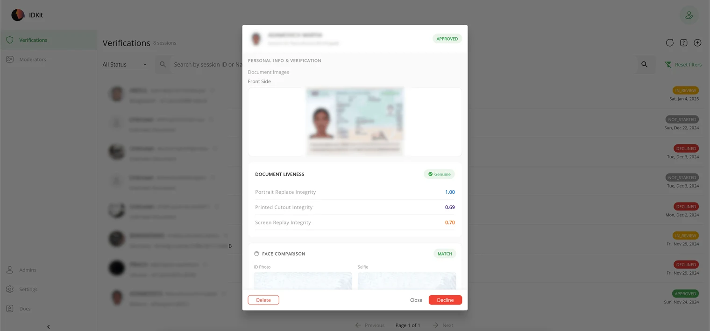
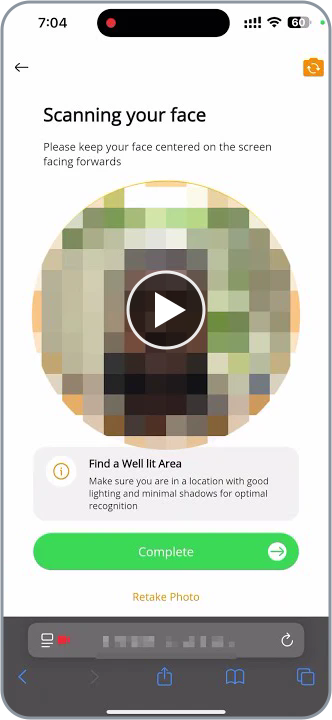

  

<h2>On-premises identity verification you fully control</h2>

Run face recognition, passive liveness detection, and ID document checks on your servers or your users’ devices.

&nbsp;
&nbsp;

 
  &ensp;
  &ensp;
  &ensp;
  &ensp;
  &ensp;
  &ensp;
  &ensp;
  &ensp;
  

### 🔍︎ _Find your SDK_

| If you need to… | Start with | Resources | Try it |
| :-- | :-- | :-- | :-- |
| Launch a complete KYC flow: ID scan, selfie, review | **[IDKit](#-featured-idkit)** | [Guide](https://docs.faceonlive.com/idkit-self-host-kyc-platform) | [Video](https://www.youtube.com/watch?v=4po8rVoGVFo) |
| Match a selfie (1:1) or search a face gallery (1:N) | **[Face&nbsp;Recognition](https://faceonlive.com/projects/face-recognition-sdk/)** | [Guide](https://docs.faceonlive.com/face-recognition-liveness-detection/introduction) | [Demo](https://huggingface.co/spaces/FaceOnLive/Face-Recognition-SDK) |
| Detect presentation attacks: photo, replay, mask | **[Face&nbsp;Liveness&nbsp;Detection](https://faceonlive.com/projects/face-liveness-detection-sdk/)** | [Guide](https://docs.faceonlive.com/face-recognition-liveness-detection/introduction) | [Demo](https://huggingface.co/spaces/FaceOnLive/Face-Liveness-Detection-SDK) |
| Read passports, ID cards, and licenses (OCR, MRZ) | **[ID&nbsp;Document&nbsp;Recognition](https://faceonlive.com/projects/id-document-recognition-sdk/)** | [Guide](https://docs.faceonlive.com/document-recognition/introduction) | [Demo](https://huggingface.co/spaces/FaceOnLive/ID-Document-Recognition-SDK) |
| Detect printed, replayed, or tampered documents | **[ID&nbsp;Document&nbsp;Liveness](https://faceonlive.com/projects/id-liveness-detection-sdk/)** | [Guide](https://docs.faceonlive.com/document-recognition/reference/linux/id-document-liveness-detection) | [Request&nbsp;a&nbsp;demo](https://faceonlive.com/contacts/) |
| Flag AI-generated and manipulated faces | **[Deepfake&nbsp;Detection](https://faceonlive.com/projects/deepfake-detection-sdk/)** | [Contact&nbsp;us](https://faceonlive.com/contacts/) | [Demo](https://huggingface.co/spaces/FaceOnLive/Deepfake-Detector) |

> **Need a complete KYC flow?** Start with **[IDKit](https://github.com/FaceOnLive/ID-Verification-OpenKYC)**. It combines document recognition, document liveness, face liveness, and face matching in one workflow.

---

### 🏆︎ _Why teams choose FaceOnLive_

<table>
<tr>
<td width="33%" valign="top">

#### 🔒︎ Your data stays yours
FaceOnLive’s offline SDKs run on your servers or your users’ devices. They send no images or biometric data to FaceOnLive.

</td>
<td width="33%" valign="top">

#### 👁︎ Passive liveness detection
One capture, with no blinks or head turns. It detects photo, screen-replay, and mask presentation attacks.

</td>
<td width="33%" valign="top">

#### 💻︎ Mobile, server & offline
Run on Android, iOS, Flutter, Linux, Windows, .NET, and Python. Offline licenses work without an internet connection.

</td>
</tr>
</table>

### ✅︎ _Evaluation results_

---

### 🚀︎ _Featured: IDKit_

**IDKit** is FaceOnLive’s self-hostable KYC platform. It includes a branded verification flow for web, iOS, and Android, an admin dashboard for reviewing sessions, and a REST API with webhooks for backend integration.

**[View repository →](https://github.com/FaceOnLive/ID-Verification-OpenKYC)**

  

| Step | What you can do |
| :-- | :-- |
| **Verify** | Document capture and recognition, document liveness, passive face liveness and ID-to-selfie matching |
| **Review** | Approve or decline sessions, inspect liveness scores, and manage moderators and admins |
| **Integrate** | Create sessions through the REST API and receive results by webhook |
| **Ship** | Deploy the admin dashboard, verification app for web, iOS, and Android, and backend cloud functions |

**Set up in five steps:** [Overview](https://docs.faceonlive.com/idkit-self-host-kyc-platform) → [Firebase setup](https://docs.faceonlive.com/idkit-self-host-kyc-platform/firebase-setup) → [Project setup](https://docs.faceonlive.com/idkit-self-host-kyc-platform/project-setup) → [Create a session (API)](https://docs.faceonlive.com/idkit-self-host-kyc-platform/creating-session-api) → [Webhooks](https://docs.faceonlive.com/idkit-self-host-kyc-platform/webhook-integration-guide)

  
   
  &nbsp;<a href="https://www.youtube.com/watch?v=4po8rVoGVFo"><b>Watch the IDKit walkthrough</b></a>: the verification flow as your users see it

---

### 📂︎ _SDK repositories_

**Two ways to integrate:** embed an SDK as a library inside your app or server, or call the [SDK-integrated server](https://docs.faceonlive.com/sdk-integrated-server)'s REST API from any language (Python, JavaScript and cURL samples included).

| Capability | Android | iOS | Linux | Windows |
| :-- | :-: | :-: | :-: | :-: |
| **Face Recognition** 1:1 verification and 1:N search, similarity score 0–1 | [SDK](https://github.com/FaceOnLive/Face-Recognition-SDK-Android) | [SDK](https://github.com/FaceOnLive/Face-Recognition-SDK-iOS) | [SDK](https://github.com/FaceOnLive/Face-Recognition-SDK-Linux) | [SDK](https://github.com/FaceOnLive/Face-Recognition-SDK-Windows) |
| **Face Liveness Detection** Detects photo, screen-replay, and mask presentation attacks | [SDK](https://github.com/FaceOnLive/Face-Liveness-Detection-SDK-Android) | [SDK](https://github.com/FaceOnLive/Face-Liveness-Detection-SDK-iOS) | [SDK](https://github.com/FaceOnLive/Face-Liveness-Detection-SDK-Linux) | — |
| **ID Document Recognition** OCR, MRZ and barcode for passports, ID cards and licences | [SDK](https://github.com/FaceOnLive/ID-Card-Passport-Recognition-SDK-Android) | [SDK](https://github.com/FaceOnLive/ID-Card-Passport-Recognition-SDK-iOS) | [SDK](https://github.com/FaceOnLive/ID-Card-Passport-Recognition-SDK-Linux) | [SDK](https://github.com/FaceOnLive/ID-Card-Passport-Recognition-SDK-Windows) |
| **ID Document Liveness** Catches printed copies, screen replays and swapped portraits | — | — | [SDK](https://github.com/FaceOnLive/ID-Document-Liveness-Detection-SDK-Linux) | — |
| **Deepfake Detection** Flags AI-generated and manipulated faces in images and video frames | — | — | [SDK](https://github.com/FaceOnLive/DeepFake-Detection-SDK-Linux) | — |
| **Touchless Fingerprint** Contactless fingerprint capture and matching, on device | [SDK](https://github.com/FaceOnLive/Touchless-Fingerprint-Recognition-SDK-Android) | [SDK](https://github.com/FaceOnLive/Touchless-Fingerprint-Recognition-SDK-iOS) | — | — |

— means no public repository is linked here yet, not that the platform is unsupported. [Ask us](https://faceonlive.com/contacts/) about other platforms.

**Also available:**
- **Flutter:** [Face Recognition & Liveness](https://github.com/FaceOnLive/Face-Recognition-SDK-Flutter) · [ID Document Recognition](https://github.com/FaceOnLive/ID-Card-Passport-Recognition-SDK-Flutter)
- **.NET:** [Face Recognition & Liveness for Windows (.NET 8)](https://github.com/FaceOnLive/Face-Recognition-SDK-Windows-DotNet)
- **Python:** [SDK-integrated server guide](https://docs.faceonlive.com/sdk-integrated-server) with Python samples for each check; the Linux SDK repositories above also include Python code

<b>More repositories:</b> OCR, sample apps and other computer-vision projects

 

- **OCR:** [Credit Card Recognition (Android)](https://github.com/FaceOnLive/Credit-Card-Recognition-SDK-Android) · [License Plate Recognition (Android)](https://github.com/FaceOnLive/License-Plate-Recognition-SDK-Android)
- **Sample app:** [Face Attendance App (Flutter)](https://github.com/FaceOnLive/Face-Attendance-App-Flutter)
- **Other:** [Pet Recognition](https://github.com/FaceOnLive/Pet-Recognition-Android-iOS) · [Background Changer](https://github.com/FaceOnLive/Realtime-Background-Changer-SDK-Android) · [Spleeter (Android/iOS)](https://github.com/FaceOnLive/Spleeter-Android-iOS) · [Offline Spleeter App](https://github.com/FaceOnLive/Offline-Spleeter-App-Flutter)

---

### 👤︎ _Built for real-world identity checks_

**Use cases:** remote onboarding · passwordless login · account recovery · duplicate-account checks · physical access · trust & safety

**Industries:** banking & fintech · insurance · telecom · healthcare · e-commerce & marketplaces · gig & delivery platforms · travel, hotels & airports · HR & video KYC · universities

### 📈︎ _From evaluation to production_

| Step | What you do | Link |
| :-: | :-- | :-- |
| **1** | Try the hosted demos with your own images | [Try hosted demos](https://huggingface.co/FaceOnLive) |
| **2** | Request an evaluation key and SDK binaries for your platform | [Request evaluation](https://faceonlive.com/contacts/) |
| **3** | Integrate in your own environment with the guides | [Docs](https://docs.faceonlive.com/) |
| **4** | Go live on an **Annual** or **Perpetual** license, sized to your SDKs, platforms and volume | [Plans](https://faceonlive.com/pricing-plans/) |

### 📖︎ _Integration guides_

| Guide | Covers |
| :-- | :-- |
| [SDK-integrated server](https://docs.faceonlive.com/sdk-integrated-server) | REST endpoints for face and document checks, with Python, JavaScript and cURL samples |
| [Face Recognition & Liveness](https://docs.faceonlive.com/face-recognition-liveness-detection/introduction) | Android, iOS, Linux and Windows SDK reference |
| [ID Document Recognition & Liveness](https://docs.faceonlive.com/document-recognition/introduction) | Android, iOS, Linux and Windows SDK reference, plus the result format |
| [Touchless Fingerprint](https://docs.faceonlive.com/touchless-fingerprint-recognition/introduction) | On-device Android and iOS SDKs |
| [IDKit](https://docs.faceonlive.com/idkit-self-host-kyc-platform) | Setup, session states, API and webhooks |

---

### 📞︎ _Connect with us_

Questions about licensing, a pilot or your platform? **[Request an evaluation](https://faceonlive.com/contacts/)** or email **[contact@faceonlive.com](mailto:contact@faceonlive.com)**. You can also reach us on any of these channels:

  &emsp;
  &emsp;
  &emsp;
  &emsp;
  &emsp;
  &emsp;
  &emsp;
  &emsp;
  

